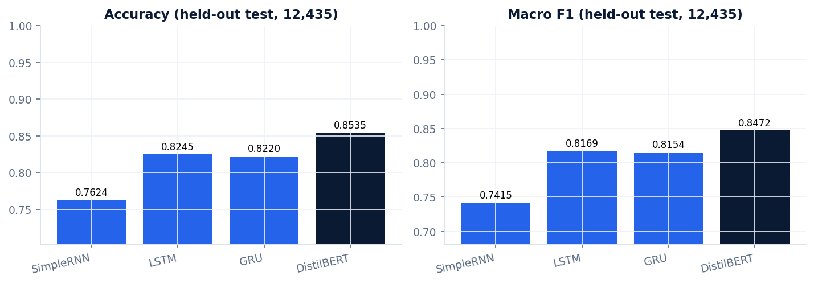
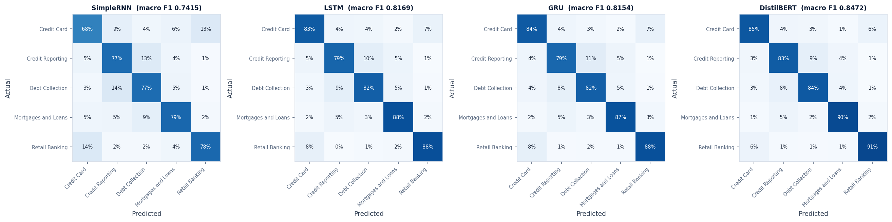
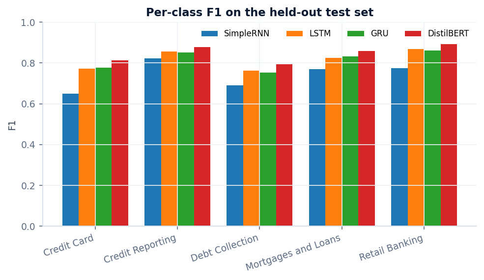
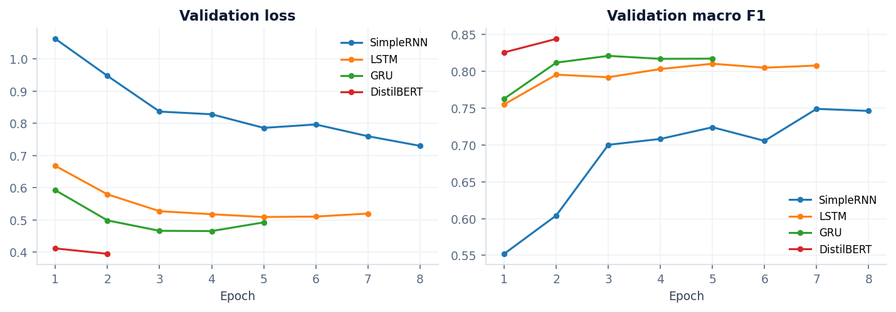
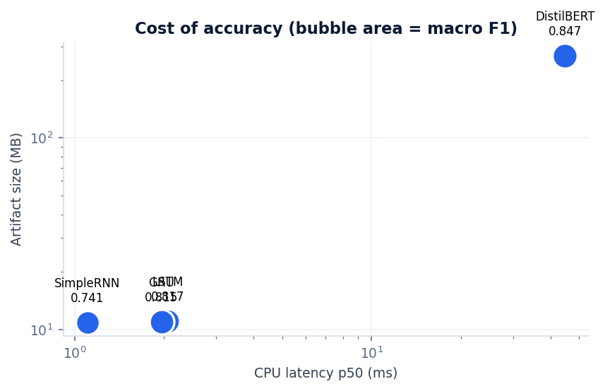
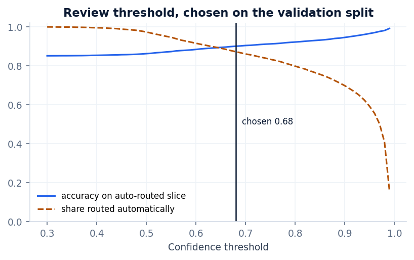
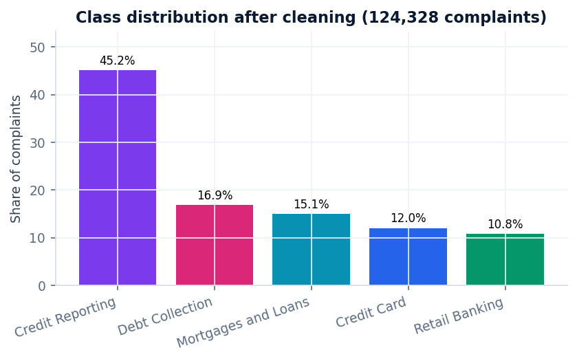

# FinTriage AI

**Intelligent Financial Complaint Classification & Routing**

Classifies English-language consumer financial complaints into five product
families and routes them, with a confidence-based recommendation for when a
human should look instead.

## Categories

`credit_card` · `credit_reporting` · `debt_collection` · `mortgages_and_loans` · `retail_banking`

## Data

[Kaggle: shashwatwork/consume-complaints-dataset-fo-nlp](https://www.kaggle.com/datasets/shashwatwork/consume-complaints-dataset-fo-nlp),
file `complaints_processed.csv` — 162,421 rows, derived from the US Consumer
Financial Protection Bureau complaint database (public domain; narratives are
scrubbed of personal information by the CFPB before publication).

Raw narratives are **not** committed here. `python -m src.data.download` fetches
them and records a SHA-256 provenance file.

### Preprocessing

| Step | Rows |
|---|---|
| As published | 162,421 |
| Drop nulls | −10 |
| Drop exact duplicate narratives | −37,939 |
| Drop complaints under 3 tokens | −144 |
| **Used** | **124,328** |

850 very long narratives are truncated at 600 tokens rather than dropped.

**Leakage control.** 9,844 near-duplicate groups covering 30,752 rows (24.7% of
the corpus) are near-identical without being exact duplicates. They are grouped
with MinHash + LSH over character 5-gram shingles and every member of a group is
kept inside a single split, so a complaint cannot appear in both training and
test in near-identical form.

**Splits.** Stratified 80/10/10, seed 42, group-aware →
99,458 / 12,435 / 12,435. Class shares agree across splits within 0.1 pp.

The exact membership is frozen in `data/processed/split_ids.csv.gz` and
fingerprinted in `results/metrics/split_fingerprint.json`, so every model —
local or on a GPU elsewhere — is trained and evaluated on provably identical
examples.

## Models

| | Architecture |
|---|---|
| SimpleRNN | Embedding(20k, 128) → RNN(64) → Dropout → Dense(64) → softmax |
| LSTM | same, LSTM cell |
| GRU | same, GRU cell |
| DistilBERT | `distilbert-base-uncased` fine-tuned, max_len 256, 2 epochs, lr 3e-5 |

All four in PyTorch, class-weighted loss (weights from the training split only),
early stopping on validation macro F1. The recurrent models mask padding by
packing sequences. Hyperparameters live in `configs/config.yaml`.

<!-- RESULTS:START -->

## Results

All four models evaluated on the same held-out test split of **12,435 complaints**, never seen during training or model selection. Every number below came from our own runs.

| Model | Accuracy | Precision (macro) | Recall (macro) | **Macro F1** | Weighted F1 | Train time | CPU latency p50 | Size | Params |
|---|---|---|---|---|---|---|---|---|---|
| SimpleRNN | 0.7624 | 0.7301 | 0.7584 | 0.7415 | 0.7664 | 86 s | 1 ms | 11 MB | 2,576,901 |
| LSTM | 0.8245 | 0.7997 | 0.8403 | 0.8169 | 0.8267 | 76 s | 2 ms | 11 MB | 2,614,149 |
| GRU | 0.8220 | 0.7980 | 0.8394 | 0.8154 | 0.8242 | 54 s | 2 ms | 11 MB | 2,601,733 |
| **DistilBERT** | 0.8535 | 0.8323 | 0.8658 | **0.8472** | 0.8549 | 4,588 s | 45 ms | 269 MB | 66,957,317 |

**Production model: DistilBERT** — selected on validation macro F1 before the test split was read. highest validation macro F1, then size and latency.

### Against the project that inspired this one

The reference implementation reports the macro F1 values below. Ours are not expected to match: we remove near-duplicate narratives across splits, which that protocol does not, so a slice of what it scores is memorisation rather than generalisation. The comparison is here for honesty, not as a claim.

| Model | Reference (published) | Ours | Difference |
|---|---|---|---|
| SimpleRNN | 0.7731 | 0.7415 | -0.0316 |
| LSTM | 0.8122 | 0.8169 | +0.0047 |
| GRU | 0.8257 | 0.8154 | -0.0103 |
| DistilBERT | 0.8433 | 0.8472 | +0.0039 |

### Per-class performance — DistilBERT

| Category | Precision | Recall | F1 | Support |
|---|---|---|---|---|
| Credit Card | 0.7784 | 0.8499 | 0.8126 | 1,492 |
| Credit Reporting | 0.9334 | 0.8307 | 0.8791 | 5,618 |
| Debt Collection | 0.7484 | 0.8429 | 0.7929 | 2,107 |
| Mortgages and Loans | 0.8229 | 0.8975 | 0.8586 | 1,874 |
| Retail Banking | 0.8783 | 0.9077 | 0.8928 | 1,344 |

### Human-review threshold

Chosen on the **validation** split, not the test split: **0.68**, the lowest threshold with >=90% accuracy on the auto-routed slice.

| | |
|---|---|
| Routed automatically | 87.3% of complaints |
| Accuracy on that slice | 90.1% |
| Sent to manual review | 12.7% |
| Expected calibration error | 0.0415 |

> Confidence values are raw softmax outputs, **not calibrated probabilities**. The ECE above is how far they sit from observed accuracy. The app presents confidence as a routing signal, never as a guarantee of correctness.

### Figures

**Accuracy and macro F1 across the four architectures**



**Confusion matrices, row-normalised**



**Per-class F1**



**Validation loss and macro F1 per epoch**



**Latency against model size**



**Threshold sweep on the validation split**



**Class distribution after cleaning**



<!-- RESULTS:END -->

## Live deployment

Private Hugging Face Space: **https://huggingface.co/spaces/fariskishtah/fintriage-ai**
(private — sign in as the owner to open it.)

| | |
|---|---|
| Hardware | ZeroGPU (`zero-a10g`) |
| Visibility | Private |
| Inference | CPU, ~45 ms per complaint |
| Weights | Bundled in the Space over LFS (268 MB), so no token is needed at runtime |
| Cost | None |

`cpu-basic` is not an option here: a **private** Gradio Space on it returns
HTTP 402 and requires PRO. ZeroGPU is the only flavour a free account can host a
private Gradio Space on, so it is the hosting tier rather than a performance
choice — the app never reserves a GPU slice, because CPU inference is already
fast enough and is the path that was measured.

### Verified live

Checked against the running Space, not against the files that were uploaded.

| Check | Result |
|---|---|
| Build | `RUNNING` |
| All five categories | predicted correctly from the live endpoint |
| Live vs local confidence | max difference **0.048 pp** across six examples |
| Top-3 | returned live |
| Review threshold | the ambiguous example returns 53.3% → *Manual Review Recommended* |
| Batch CSV | 7 rows uploaded → 5 classified, 2 skipped, download returned |
| Analytics | real session counts, 5 of 5 categories |
| Human override | recorded, dashboard reflects it |
| Explainability | Integrated Gradients, 19 token attributions |
| Input validation | empty and too-short inputs rejected with clear messages |
| Restart | model reloads, inference unchanged, all 6 model files persist |
| Served CSS | brand tokens, `@media (max-width: 640px)` and the overflow fix all present |

The live Space runs **torch 2.8.0** (ZeroGPU rejects 2.5.1), while training and
evaluation used 2.5.1. The confidence difference that causes is at most
0.048 pp, which is below the UI's own display granularity.

## Reproduce

```bash
python -m venv .venv && .venv/bin/pip install -r requirements-dev.txt
```

```bash
.venv/bin/python -m src.data.download
```

```bash
.venv/bin/python scripts/materialize_splits.py
```

```bash
for c in SimpleRNN LSTM GRU; do .venv/bin/python scripts/train_rnn.py --cell $c; done
```

DistilBERT needs a GPU — on an Apple M2 it benchmarks at 49.6 s/step, about 86
hours for the full run. Use `notebooks/kaggle_train_distilbert.ipynb` on a Kaggle
T4 instead.

```bash
.venv/bin/python scripts/select_model.py && .venv/bin/python scripts/evaluate.py
```

```bash
.venv/bin/python app.py
```

## Tests

```bash
.venv/bin/python -m pytest -q
```

## Attribution

The problem framing, the five-category label set and the four-model comparison
were inspired by
[Razan3ssam/Consumer-Complaint-Classifier](https://github.com/Razan3ssam/Consumer-Complaint-Classifier)
(found via the author's LinkedIn post). That project's evaluation protocol —
dataset, 80/10/10 stratified split at seed 42, and the model hyperparameters — is
deliberately reused so the numbers are comparable. An audit of what was reused,
what was redesigned and why is in `docs/ORIGINAL_PROJECT_AUDIT.md`.

The original repository carries no license, so no code was copied from it. This
implementation is independent work. Its published metrics are reproduced in the
audit document as **reference only** and are never presented as ours.

## Limitations

- English only, five product families, one label per complaint.
- Confidence scores are raw softmax outputs, not calibrated probabilities.
- Token attributions show local sensitivity, not the model's reasoning.
- Complaints spanning several products are inherently ambiguous.

## Licence

MIT, for this implementation. The dataset keeps its own terms.
